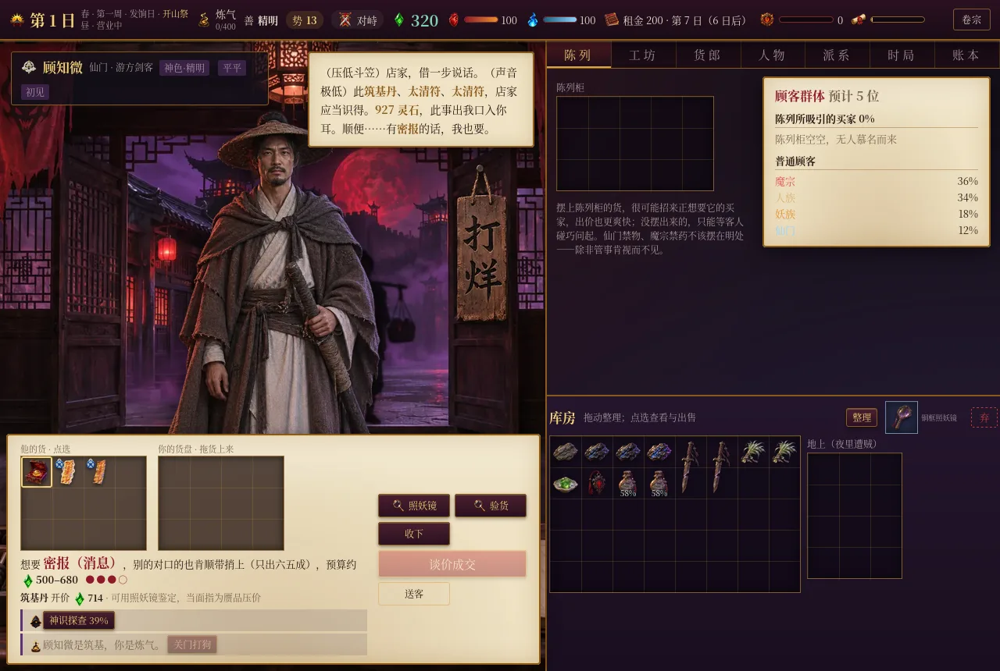
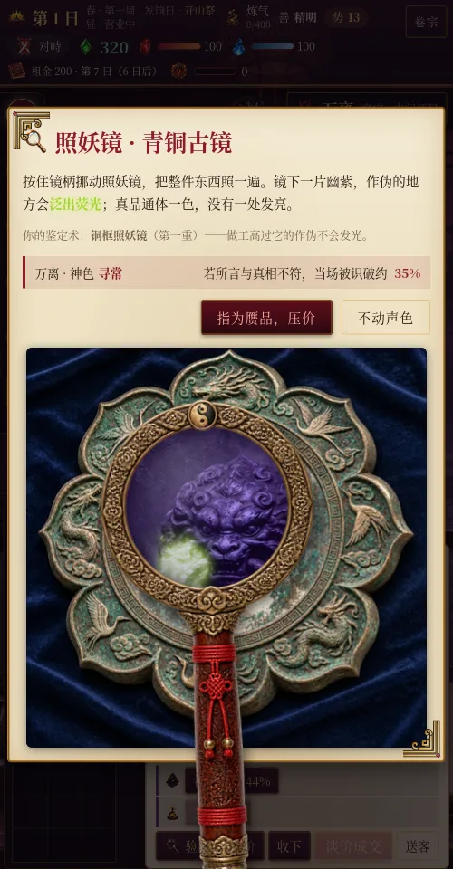
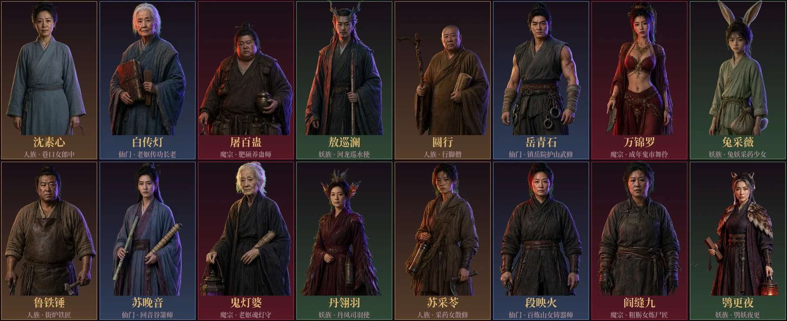
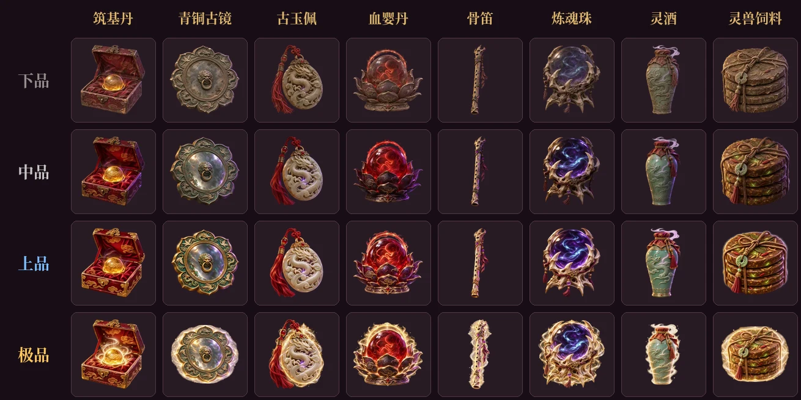
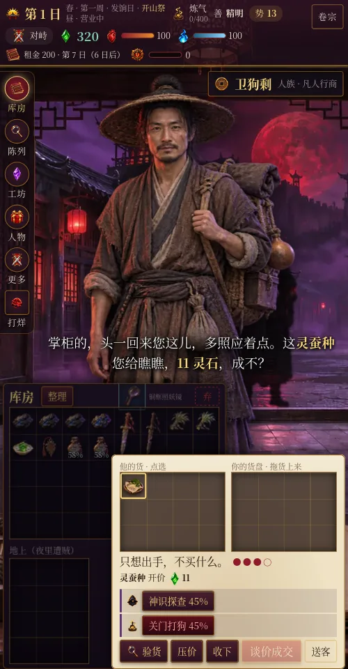
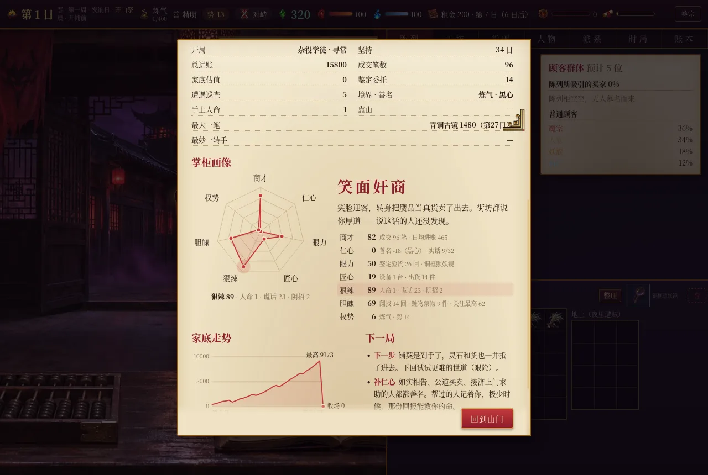

<div align="center">


# 魔门当铺 · 来路不明

**在魔道宗门的杂役区开一间当铺。收赃、验伪、撒谎、下蛊、杀人夺宝——<br>只要能攒够灵石买下铺契。**

*A dark-xianxia pawnshop sim. Buy stolen goods, spot forgeries, lie, poison, and murder your way to owning the shop.*

[](https://lqszhsp.github.io/dangpu/)
&nbsp;
[](../LICENSE)


</div>

---

> 人、仙、魔、妖四方争斗。你在血煞宗杂役区开了间当铺。
> 租子七日一涨——买下铺契之前，别被执法堂锁走。

隔着自家柜台，你看着一个又一个客人推门进来：压低斗笠的仙门剑客想卖一颗筑基丹，顺便打听一份**密报**；拾荒的凡人背着一篓不知从哪座坟里刨出来的东西；妖修的眼睛在门外的夜色里发着光。

**你可以做个好人。只是好人在这里活不过第三期租子。**

<p align="center">
  
  <br><sub>柜台接客 —— 他带来几样货、也想买几样，你把货拖上货盘，谈一个总差价。神识探查他的底细，或者……关门打狗。</sub>
</p>

## ✦ 这不是一个普通的当铺游戏

<table>
<tr>
<td width="50%" valign="top">

### 🔍 照妖镜下，赝品无所遁形
筑基丹、古玉佩、青铜古镜，各有四种作伪手法——蜡衣包金、后刻丹纹、染色仿沁、断口补胶、刷胶假锈、后焊镜钮……
照妖镜像一盏紫外灯：**按住镜柄在货上移动，作伪的地方泛出荧光。**

### 🎭 看清了真假，说不说实话由你
把真品说成赝品，委托人多半贱卖给你；把赝品当真货卖出去，赚得更多。
憨直的凡人好骗，老辣的仙门难骗；当场被识破丢声望，没被识破的谎话，**日后也可能被翻出旧账。**

### 🗡️ 修为够高，就能关门打狗
修为高过对方，就能在柜台上动手，或者夜里截杀。灵石、货物、尸身、魂魄、精血、妖丹都归你。
被人看见？执法堂找上门。杀的是仙门卧底？执法堂只当你替宗门除害。

</td>
<td width="50%" valign="top">



</td>
</tr>
</table>

### 更多的门道

| | |
| --- | --- |
| 🧪 **夜里开炉** | 炼器炉、炼丹炉、洗灵池、药圃、灵酒坛、傀儡货摊……**18 种设备**夜夜运转，聚灵阵的灵力按顺序分配，不够就私接灵脉 |
| 🐛 **养蛊成王** | 封盅斗蛊，最凶的吞掉最弱的——吞满三只成万毒蛊，吞满八只成**蛊王**。下蛊只能掺进吃食里，谁吃下去谁中蛊 |
| 🪦 **夜间拾荒** | 炼器坊废料场、乱葬岗、万魔窟外围、古战场……背篓格子有限，越翻越险，越险越值钱 |
| 👁️ **执法堂盯着你** | 赃物有追查天数，仙门禁物不能摆在明面上；巡查可以贿赂，暗格搜不到。关注满一百——锁拿入狱 |
| 🧭 **四方势力** | 人族、仙门、魔宗、妖族各有声望；陈列柜摆什么决定谁来，陈列妖丹会激怒妖族 |
| 📜 **人人都记得你** | **63 位有名有姓的人物**，各有生平、命数和行当，记得你骗过谁、帮过谁、杀过谁的亲人。按身份懂四十多条门道，交情够了才肯教 |
| 🎲 **十一种出身 · 四档世道** | 杂役学徒、灵泉贩子、销赃客、丹房药童、养蛊人、炼尸匠、拾荒客、育兽师、画符先生、炼器匠……或者，一无所有 |

## ✦ 众生相

<p align="center">
  
</p>

每个人都有**七种神态**：平常、欢喜、恼怒、惊惧、狡黠——还有被种下魂印受你操控、被伤毒拖垮的样子；不少人还画了中了情蛊的模样。你对他做过什么，都写在他脸上。

<p align="center">
  
</p>

## ✦ 一百五十种货，四档品相

<p align="center">
  
</p>

## ✦ 夜里去哪儿

<p align="center">
  
</p>

## ✦ 手机上也能玩

<table>
<tr>
<td width="38%"></td>
<td valign="middle">

界面有两套排版，**按屏幕自动切换**：

- **竖屏**（手机、平板）：场景铺满全屏，来客从头到腰都在画面里，说的话是画面正中的字幕；库房和柜台窗口贴着内容叠放，点一下翻到上面。
- **宽屏**（电脑、平板横屏）：场景在左，陈列、工坊、人物、派系、账本在右。

点一下货弹出详情卡，按住拖动挪位置；照妖镜按把手拖，镜片不会被手指挡住。

进度在每天清晨自动存档。

</td>
</tr>
</table>

## ✦ 结局：胜利也是一种讽刺

攒够灵石，买下铺契——然后你会发现，过户的契税、宗门印钱、执法堂的平安钱、过户的茶水……会把你剩下的灵石和货一样一样刮走。

<p align="center">
  
  
</p>

收场时，游戏按你这一局的所作所为量出**七样脾性**（商才、仁心、眼力、匠心、狠辣、胆魄、权势），画成蛛网图，给你定个名号——

> **笑面奸商**：笑脸迎客，转身把赝品当真货卖了出去。街坊都说你厚道——说这话的人还没发现。

> **两面人**：白天施粥，夜里埋人。善名与人命都记在账上，各记各的。

> **鉴宝痴**：照妖镜照遍了天下赝品，独独没照清这世道。

你会是哪一种？

---

## ▶ 开始玩

**在线**：👉 **[lqszhsp.github.io/dangpu](https://lqszhsp.github.io/dangpu/)**

**本地**：没有依赖，没有构建步骤。

```bash
git clone https://github.com/lqszhsp/dangpu.git
cd dangpu
# 直接用浏览器打开 index.html 即可（支持 file://）
# 或者起个本地服务：
python3 -m http.server 8000   # 然后访问 http://localhost:8000
```

**攻略**：[guide/](../guide/README.md) —— 开局、经营、配方、拾荒修为、伤毒求医、人物派系、执法堂、时令战事、货物图鉴。攻略里的数字、名称、配方都由脚本从游戏代码里取出并对账，配方是真的开一炉跑出来的。

**开发者文档**：[README.md](../README.md) —— 机制设计、排版规则、测试与上线工具。

## ✦ 制作人员

这是一款**人类与 AI 共同完成**的游戏。

<table>
<tr>
<td align="center" width="33%">
<br>
<b>游戏设计</b><br>
<a href="https://github.com/lqszhsp">@lqszhsp</a><br>
<sub>世界观、玩法、数值、每一个讽刺的结局</sub>
</td>
<td align="center" width="33%">
<br><br>
<b>程序</b><br>
<a href="https://www.anthropic.com/claude">Claude Opus 5.5</a><br>
<sub>约 1.4 万行原生 JavaScript，外加测试、模拟玩家与上线工具</sub>
</td>
<td align="center" width="33%">
<br><br>
<b>美术</b><br>
gpt-image<br>
<sub>1200 多张立绘、货物、设备与场景</sub>
</td>
</tr>
</table>

## ✦ 致敬

核心机制取自 **《Probably Stolen》**（深空当铺）——日循环、报价面板、放大镜鉴定、格子库存、跨夜设备产能、举报通缉犯、上涨的租金与买店结局——并改编进仙侠魔道的世界：鉴定变成照妖镜，净水变成灵泉，鼠类选育变成养蛊，五派声望变成人仙魔妖四方。完整的机制对照见[开发者文档](../README.md#机制对照)。

## ✦ 许可

[MIT](../LICENSE)。欢迎 Fork、改编、做你自己的当铺。

<div align="center">
<br>
<sub>血月当空，杂役区的门又开了。<b>下一位客人，请进。</b></sub>
</div>
