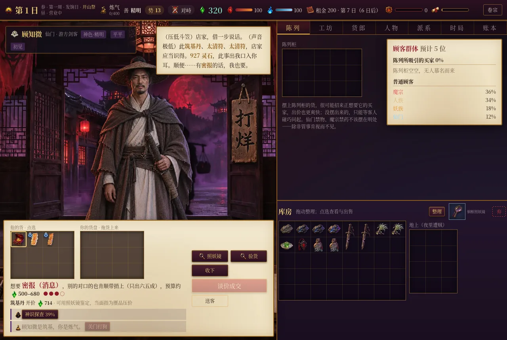
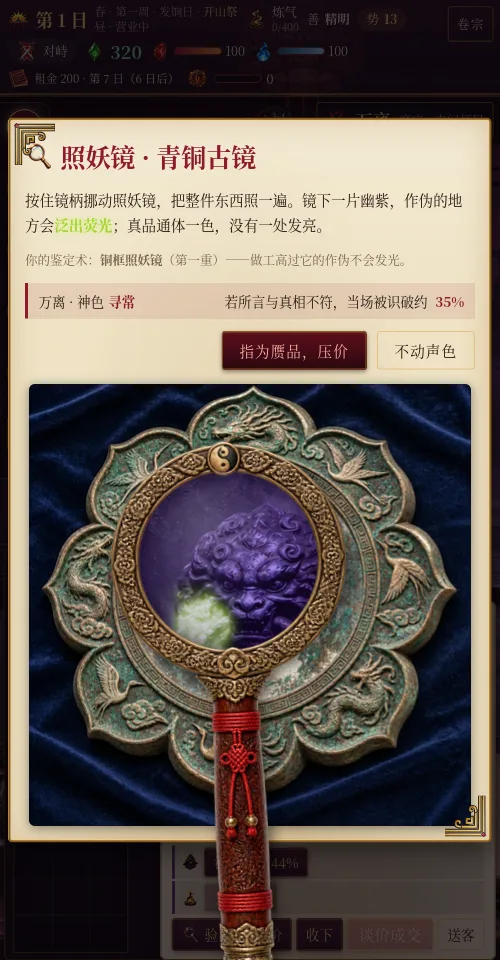
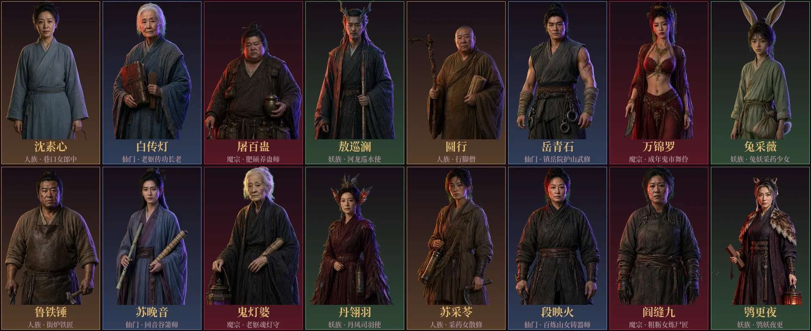
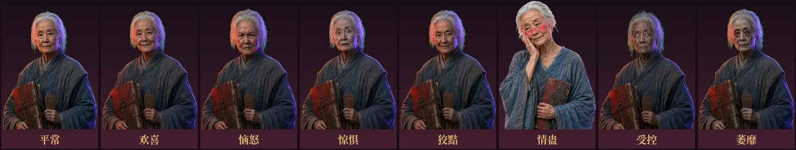
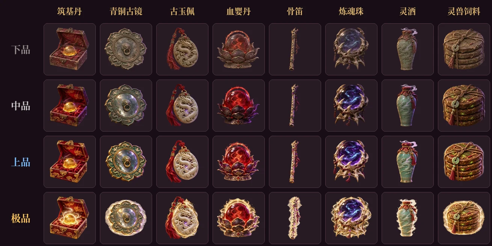
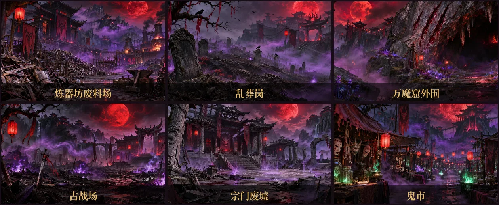
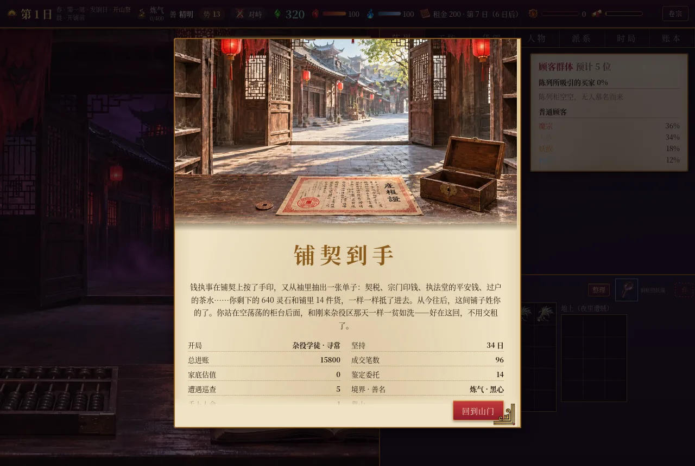
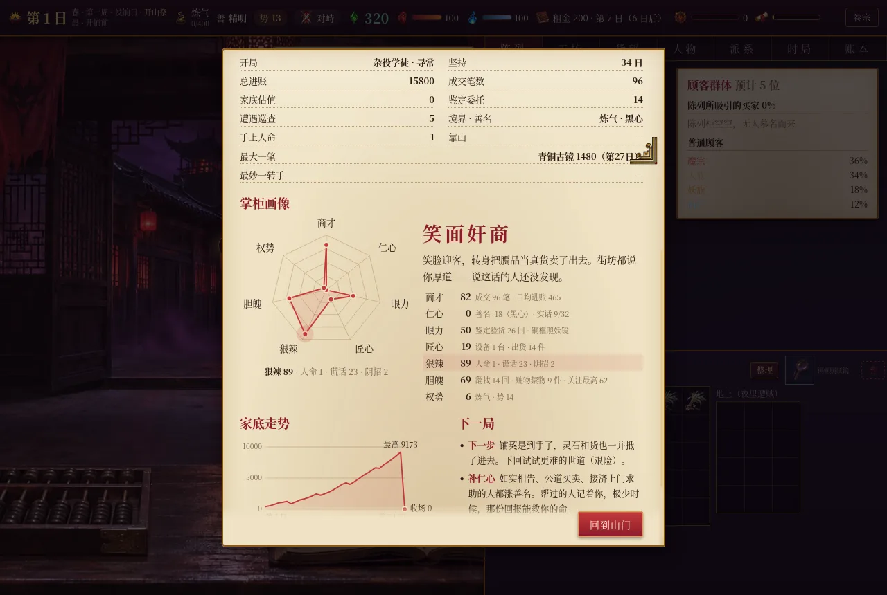
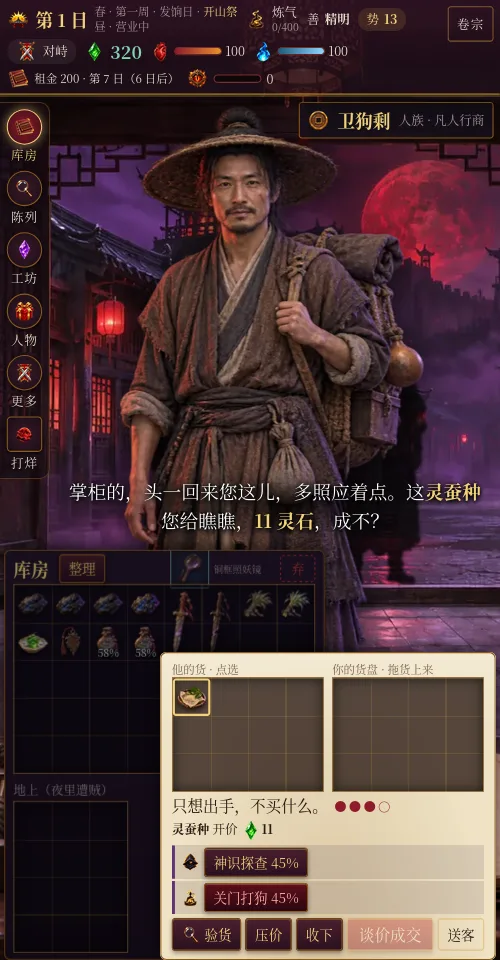

# 魔门当铺 · 来路不明

**在魔道宗门的杂役区开一间当铺。 收赃、验伪、撒谎、下蛊、杀人夺宝——只为攒够灵石，买下铺契。**

&nbsp;

> 人、仙、魔、妖四方争斗。你在血煞宗杂役区开了间当铺。
> 租子七日一涨——买下铺契之前，别被执法堂锁走。

压低斗笠的仙门剑客来卖筑基丹，顺便打听一份密报；拾荒的凡人背着一篓不知从哪座坟里刨出来的东西；妖修的眼睛在门外的夜色里发着光。

**你可以做个好人。只是好人在这里，未必付得起下一期的租子。**

  

## 你会在这里做什么

<table>
<tr>
<td width="55%" valign="top">

**🔍 用照妖镜辨真假** 
丹药、玉佩、古镜，赝品泛滥。按住照妖镜在货上移动，作伪的地方会泛出荧光。

**🎭 决定说不说实话** 
把真品说成赝品压价收下，把赝品当真货卖出去——只要别被当场识破。

**🗡️ 修为够了，关门打狗** 
修为高过客人，就能在柜台上动手。他的灵石、货物、魂魄都归你——如果没人看见的话。

**🌙 夜里开炉、养蛊、拾荒** 
炼丹炼器、封盅斗蛊养出蛊王，或去乱葬岗翻找宝贝。越险的地方越值钱。

**👁️ 在四方势力之间周旋** 
人族、仙门、魔宗、妖族各有脾气，执法堂一直盯着你。杂役区的每个人，都记得你做过的事。

</td>
<td width="45%" valign="top">

</td>
</tr>
</table>

## 众生相

六十多位有名有姓的人物，各有来历与命数。

  

你对一个人做过什么，都会写在他脸上——欢喜、恼怒、惊惧，中了情蛊，或被你种下魂印、任你摆布。

  

## 一百五十种货，四档品相

  

## 夜里去哪儿

  

## 结局：赢了，也是一种讽刺

攒够灵石买下铺契——然后发现，契税、印钱、执法堂的平安钱，会把你剩下的灵石和货一样一样刮走。

收场时，游戏按你这一局的所作所为画出脾性蛛网图，给你定个名号：

  
  

> **笑面奸商** —— 笑脸迎客，转身把赝品当真货卖了出去。街坊都说你厚道——说这话的人还没发现。

你会是哪一种？

## 手机上也能玩

<table>
<tr>
<td width="40%"></td>
<td valign="middle">

手机竖屏、电脑宽屏，界面自动适配。

不用安装，不用注册，**点开链接就能玩**，进度自动存在浏览器里。

 

### 👉 [lqszhsp.github.io/dangpu](https://lqszhsp.github.io/dangpu/)

</td>
</tr>
</table>

## 制作

这是一款**人类与 AI 共同完成**的游戏。

<table>
<tr>
<td align="center" width="33%">
 
<b>游戏设计</b> 
<a href="https://github.com/lqszhsp">@lqszhsp</a>
</td>
<td align="center" width="33%">
  
<b>程序</b> 
Claude Opus 5.5
</td>
<td align="center" width="33%">
  
<b>美术</b> 
gpt-image
</td>
</tr>
</table>

玩法灵感来自 **《Probably Stolen》**，改编进仙侠魔道的世界。

## 更多

- 📖 [玩家攻略](guide/README.md) —— 开局、配方、拾荒、人物、执法堂……
- 🛠️ [开发说明](docs/开发说明.md) —— 机制设计、本地运行、测试与工具
- 📄 [MIT 许可](LICENSE) —— 欢迎 Fork、改编，做你自己的当铺

 
血月当空，杂役区的门又开了。<b>下一位客人，请进。</b>

